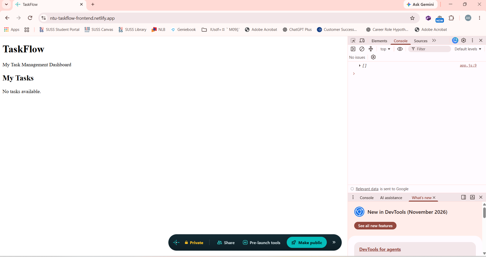

# TaskFlow API

A simple task management REST API built with Spring Boot as part of the NTU AI Engineering Module 3 assignment.

This project continues into the Module 4 End-of-Module Assignment: Dockerize & Deploy, where the API is containerized using Docker and deployed to a cloud hosting platform.

## Live Application URL

The TaskFlow API was successfully deployed on Render.

The initial deployment was planned for Railway, as specified in the assignment. However, Railway required a paid subscription for new accounts, so Render was used as an alternative.

**Live API:**

https://module3-taskflow-api-h255.onrender.com/api/tasks

The deployment was verified successfully, with the API returning an empty JSON array (`[]`), indicating that the application was running correctly.

The application is hosted using Render's free plan, which may require additional startup time after a period of inactivity.

## Screenshot: Deployment Dashboard

The screenshot below shows the TaskFlow API successfully deployed and running on Render.


## Screenshot: Live Application

The screenshot below shows the deployed TaskFlow API responding successfully through its public Render URL.


## Errors and Failures

**Completed:**

- Task 1: Created a multi-stage Dockerfile.
- Task 2: Successfully built and tested the Docker image locally.
- Task 3: Pushed the Dockerfile to GitHub and deployed the application using Render.
- Task 4: Verified the live API endpoint successfully.

**Issue encountered:**

Railway deployment could not proceed because new accounts were required to upgrade to a paid subscription.

**Resolution:**

Used Render's free hosting plan to deploy the same Dockerized Spring Boot application. The deployment was successful, and the live API returned `[]`.

## Stretch Goals (Optional)

**Progress: 4 of 5 TaskFlow-related stretch goals completed (Options 1, 2, 4 and 5).**

### Stretch Goal Option 1: Add a CI Pipeline — Completed

Implemented a GitHub Actions Continuous Integration (CI) pipeline that automatically builds, tests and publishes the TaskFlow API Docker image to Docker Hub whenever changes are pushed to the `main` branch.

**CI Tool:** GitHub Actions

**Workflow File:** `.github/workflows/ci.yml`

**Pipeline Steps:**

1. Check out the GitHub repository.
2. Set up Java 21 using Eclipse Temurin.
3. Build and test the application using `mvn clean verify`.
4. Authenticate with Docker Hub using GitHub Actions repository secrets.
5. Build and publish Docker images tagged `latest` and with the Git commit SHA.

**Successful Pipeline Run:**

https://github.com/akleung1511/module3-taskflow-api/actions/runs/41610673213

**Docker Hub Repository:**

https://hub.docker.com/r/andrewl1511/taskflow

**CI Pipeline Results:**

| Check | Result |
|---|---|
| GitHub Actions workflow triggered by push to `main` | Passed |
| Java 21 environment configured | Passed |
| Maven build and automated tests | Passed |
| Docker Hub authentication | Passed |
| Docker image build | Passed |
| Docker image publication | Passed |

The first GitHub Actions CI run completed successfully.

Docker Hub was verified to contain a new image tagged with the Git commit SHA and an updated `latest` tag.

**Security:**

Docker Hub credentials are stored securely in GitHub Actions repository secrets:

- `DOCKERHUB_USERNAME`
- `DOCKERHUB_TOKEN`

No Docker Hub credentials are hardcoded in the workflow file.

**GitHub Actions Screenshot:**


**Docker Hub CI Tags Screenshot:**


### Stretch Goal Option 2 — Frontend Deployment (Netlify)

**Status:** Completed

A simple TaskFlow frontend was developed using HTML,
CSS and JavaScript and deployed to Netlify.

**Live Frontend:**
https://ntu-taskflow-frontend.netlify.app

**Live Backend API:**
https://module3-taskflow-api-h255.onrender.com/api/tasks

**Implementation:**
- Frontend files are located in the `frontend/` directory.
- JavaScript fetches task data from the deployed Render API.
- Displays "No tasks available." when the API returns an empty list.
- Spring Boot CORS configuration allows requests from Netlify.
- Live frontend and backend connection successfully verified.

**Deployment Evidence:**




### Stretch Goal Option 4: Publish Versioned Docker Images — Completed

Successfully published two versions of the TaskFlow API Docker image to Docker Hub using Semantic Versioning (MAJOR.MINOR.PATCH).

**Docker Hub Repository:**

https://hub.docker.com/r/andrewl1511/taskflow

**Published Versions:**

| Docker Tag | Description |
|---|---|
| `1.0.0` | Initial TaskFlow API Docker release |
| `1.0.1` | Second release with Maven application version updated to `0.0.2-SNAPSHOT` |
| `latest` | Points to the most recently published CI build |
| `sha-<commit-sha>` | Identifies the Docker image built from a specific Git commit |

Both versioned images were successfully published to Docker Hub.

Version `1.0.1` was tested locally using the `/api/tasks` endpoint, which returned `[]`.

The second release includes an application version metadata update rather than changes to API functionality or a bug fix.

**Versioning Scheme:**

- `MAJOR.MINOR.PATCH` is used for manually published versioned releases.
- Git commit SHA tags identify individual builds generated by GitHub Actions.
- `latest` is automatically updated by the CI pipeline whenever a new build is successfully published.

The versioned tags `1.0.0` and `1.0.1` remain available even when `latest` changes.

**Docker Hub Tags Screenshot:**


### Stretch Goal Option 5: Security Check with OWASP Dependency-Check — Completed

#### Objective

Perform a dependency vulnerability scan using OWASP Dependency-Check, identify known security vulnerabilities, apply appropriate fixes, and document any remaining findings.

This security check was performed locally in WSL2 Ubuntu using Java 21, Maven and OWASP Dependency-Check 13.0.0.

#### 1. Running the Security Scan

The following command was used:

```bash
mvn org.owasp:dependency-check-maven:13.0.0:check -DnvdApiKeyEnvironmentVariable=NVD_API_KEY
```

The NVD API key was supplied through a local environment variable rather than being committed to the repository.

The scanner generated the HTML report at:

```text
target/dependency-check-report.html
```

#### 2. Initial Scan Results

Date: 3 November 2026

| Metric | Result |
|---|---:|
| Dependencies scanned | 129 |
| Unique dependencies | 52 |
| Vulnerable dependencies | 5 |
| Reported vulnerability findings | 16 |
| Suppressed vulnerabilities | 0 |
| Maven scan result | BUILD SUCCESS |

The initial scan identified vulnerabilities associated with:

- Apache Tomcat 11.0.24
- Netty Transport 4.2.17.Final
- Kotlin Standard Library 2.3.21
- Kotlin Standard Library Common 1.9.10
- Spring Boot DevTools 4.1.1

#### 3. Security Fixes Applied

Two targeted dependency updates were made in `pom.xml`.

| Dependency | Previous version | Updated version |
|---|---|---|
| Apache Tomcat | 11.0.24 | 11.0.25 |
| Netty | 4.2.17.Final | 4.2.18.Final |

The following Maven properties were added:

```xml
<tomcat.version>11.0.25</tomcat.version>
<netty.version>4.2.18.Final</netty.version>
```

These versions were selected based on the fixes identified in the OWASP vulnerability report.

The Maven dependency tree was used to confirm that the updated Tomcat and Netty libraries were correctly resolved.

#### 4. Verification After Security Updates

The application was tested using:

```bash
mvn clean verify
```

Results:

- Tests run: 1
- Failures: 0
- Errors: 0
- Skipped: 0
- Maven result: BUILD SUCCESS

The application compiled and packaged successfully after the dependency updates.

#### 5. OWASP Rescan Results

OWASP Dependency-Check was run again after updating Tomcat and Netty.

| Metric | Before fixes | After fixes |
|---|---:|---:|
| Vulnerable dependencies | 5 | 3 |
| Reported vulnerability findings | 16 | 4 |
| Tomcat findings | 11 | 0 |
| Netty findings | 1 | 0 |
| Kotlin findings | 3 | 3 |
| Spring Boot DevTools findings | 1 | 1 |

**Result: 12 of 16 reported findings were cleared, representing a 75% reduction.**

The rescan completed successfully using the previously downloaded NVD database.

#### 6. Remaining Vulnerabilities and Assessment

Four reported vulnerability findings remain associated with three dependency files.

**Kotlin Standard Library — CVE-2026-53914**

The report flags Kotlin runtime libraries associated with the Spring AI OpenAI integration. The vulnerability description concerns unsafe deserialization of Kotlin build-cache metadata.

The applicability to this Java-based application has not been confirmed. The runtime libraries were not upgraded solely on the basis of this finding, pending further verification of affected components and compatible dependency versions.

**Kotlin Standard Library Common — CVE-2026-53914 and CVE-2020-29582**

The dependency is introduced transitively through OkHttp and Okio.

CVE-2020-29582 concerns insecure temporary-file permissions in older Kotlin versions. Further verification is required to establish whether the reported runtime dependency and affected functionality present an exploitable risk in TaskFlow.

**Spring Boot DevTools — CVE-2022-31691**

The report associates Spring Boot DevTools 4.1.1 with CVE-2022-31691.

However, the published vulnerability description concerns Spring Tools IDE and VS Code extensions using SnakeYAML, rather than necessarily the Spring Boot DevTools runtime dependency.

This is a possible product-identification false positive. No suppression was applied because the assessment has not been fully validated.

**Outstanding action:** Review applicable vendor advisories and compatible dependency updates before considering the remaining findings resolved.

#### 7. Credential and Secret Management Check

A preliminary search of tracked project files was performed using:

```bash
git grep -n -i -E 'api[_-]?key|secret|password|token' -- ':!README.md' ':!pom.xml'
```

The review confirmed the following configurations:

- Docker Hub credentials are referenced using GitHub Actions secrets.
- The OpenAI API key is referenced using the `OPENAI_API_KEY` environment variable.
- Maven wrapper files contain standard environment-variable references for credentials.
- No obvious hardcoded credential values were identified in the reviewed search results.

This was a preliminary check of tracked files, not a comprehensive secret audit of Git history or untracked files.

#### 8. Scan Limitations

- OWASP Dependency-Check is a best-effort vulnerability scanner and may produce false positives or false negatives.
- The .NET Assembly Analyzer could not initialise because the required .NET runtime was not installed.
- The Sonatype OSS Index Analyzer was disabled because authentication credentials were unavailable.
- The NVD-based analysis completed successfully.
- The scan results do not establish that all application security risks have been eliminated.

#### 9. Conclusion

Stretch Goal Option 5 was completed by performing a local OWASP Dependency-Check scan, analysing its findings, applying targeted Tomcat and Netty security updates, and verifying the application build.

The reported vulnerability findings decreased from 16 to 4.

The remaining findings have been documented for further applicability assessment and remediation. No unverified findings were suppressed.

The application passed Maven verification after the dependency updates.

### Other Stretch Goals

The remaining TaskFlow-related stretch goals have not been attempted at this stage.

Further stretch goals may be attempted if time and technical knowledge permit.

## Getting Started

### Prerequisites

- Java 21
- Maven (or the included Maven Wrapper)
- Docker

### Running the Application Locally

From the project root:

```bash
./mvnw spring-boot:run
```

The application starts at:

http://localhost:8080

### Building the Docker Image

```bash
docker build -t taskflow:latest .
```

### Running the Docker Container

```bash
docker run -p 8080:8080 taskflow:latest
```

### Testing the API

```bash
curl http://localhost:8080/api/tasks
```

Expected response when no tasks exist:

```json
[]
```

### Pulling the Published Docker Image

The most recently published image can also be pulled directly from Docker Hub:

```bash
docker pull andrewl1511/taskflow:latest
```

To pull a specific version:

```bash
docker pull andrewl1511/taskflow:1.0.1
```

### Running the Published Docker Image

```bash
docker run -p 8080:8080 andrewl1511/taskflow:latest
```

## Project Links

**GitHub Repository:**

https://github.com/akleung1511/module3-taskflow-api

**Live Application (Render):**

https://module3-taskflow-api-h255.onrender.com/api/tasks

**Docker Hub Repository:**

https://hub.docker.com/r/andrewl1511/taskflow

**Successful GitHub Actions CI Run:**

https://github.com/akleung1511/module3-taskflow-api/actions/runs/41610673213
