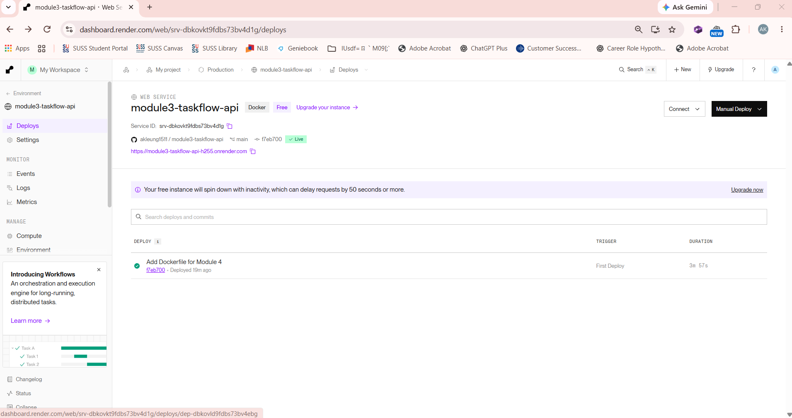
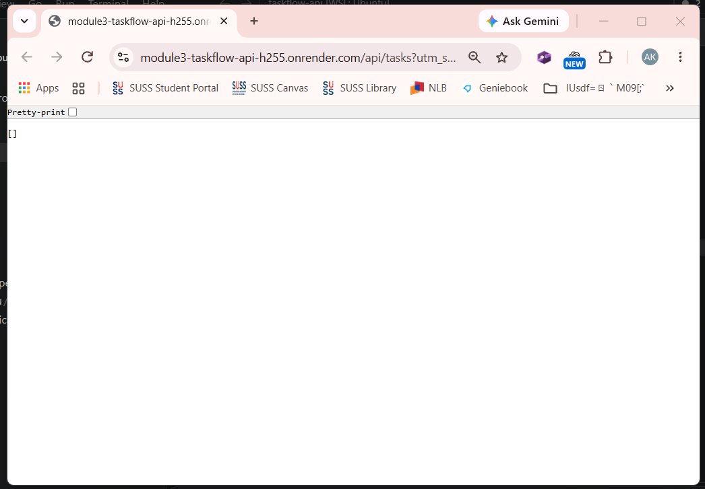
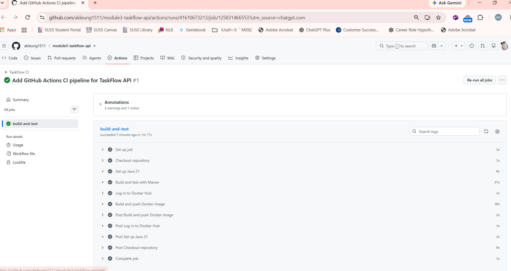
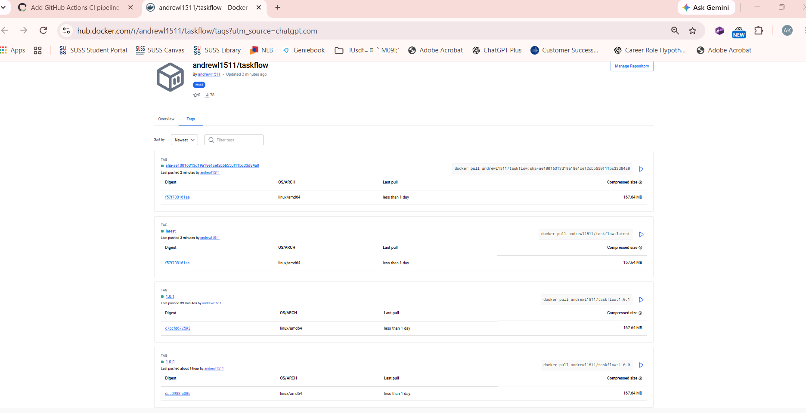
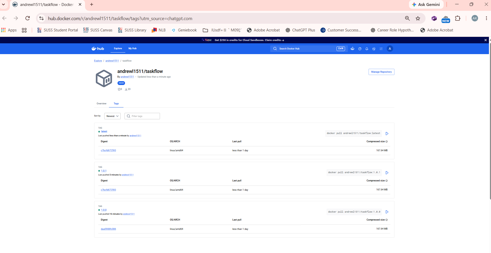

# TaskFlow API

A simple task management REST API built with Spring Boot as part of the NTU AI Engineering Module 3 assignment.

This project continues into the Module 4 End-of-Module Assignment: Dockerize & Deploy, where the API is containerized using Docker and deployed to a cloud hosting platform.

## Live Application URL

The TaskFlow API was successfully deployed on Render.

The initial deployment was planned for Railway, as specified in the assignment. However, Railway required a paid subscription for new accounts, so Render was used as an alternative.

**Live API:**

https://module3-taskflow-api-h255.onrender.com/api/tasks

The deployment was verified successfully, with the API returning an empty JSON array (`[]`), indicating that the application was running correctly.

The application is hosted using Render's free plan, which may require additional startup time after a period of inactivity.

## Screenshot: Deployment Dashboard

The screenshot below shows the TaskFlow API successfully deployed and running on Render.



## Screenshot: Live Application

The screenshot below shows the deployed TaskFlow API responding successfully through its public Render URL.



## Errors and Failures

**Completed:**

- Task 1: Created a multi-stage Dockerfile.
- Task 2: Successfully built and tested the Docker image locally.
- Task 3: Pushed the Dockerfile to GitHub and deployed the application using Render.
- Task 4: Verified the live API endpoint successfully.

**Issue encountered:**

Railway deployment could not proceed because new accounts were required to upgrade to a paid subscription.

**Resolution:**

Used Render's free hosting plan to deploy the same Dockerized Spring Boot application. The deployment was successful, and the live API returned `[]`.

## Stretch Goals (Optional)

**Progress: 2 of 4 TaskFlow-related stretch goals completed (Options 1 and 4).**

### Option 1: Add a CI Pipeline — Completed

Implemented a GitHub Actions Continuous Integration (CI) pipeline that automatically builds, tests and publishes the TaskFlow API Docker image to Docker Hub whenever changes are pushed to the `main` branch.

**CI Tool:** GitHub Actions

**Workflow File:** `.github/workflows/ci.yml`

**Pipeline Steps:**

1. Check out the GitHub repository.
2. Set up Java 21 using Eclipse Temurin.
3. Build and test the application using `mvn clean verify`.
4. Authenticate with Docker Hub using GitHub Actions repository secrets.
5. Build and publish Docker images tagged `latest` and with the Git commit SHA.

**Successful Pipeline Run:**

https://github.com/akleung1511/module3-taskflow-api/actions/runs/41610673213

**Docker Hub Repository:**

https://hub.docker.com/r/andrewl1511/taskflow

**CI Pipeline Results:**

| Check | Result |
|---|---|
| GitHub Actions workflow triggered by push to `main` | Passed |
| Java 21 environment configured | Passed |
| Maven build and automated tests | Passed |
| Docker Hub authentication | Passed |
| Docker image build | Passed |
| Docker image publication | Passed |

The first GitHub Actions CI run completed successfully.

Docker Hub was verified to contain a new image tagged with the Git commit SHA and an updated `latest` tag.

**Security:**

Docker Hub credentials are stored securely in GitHub Actions repository secrets:

- `DOCKERHUB_USERNAME`
- `DOCKERHUB_TOKEN`

No Docker Hub credentials are hardcoded in the workflow file.

**GitHub Actions Screenshot:**



**Docker Hub CI Tags Screenshot:**



### Option 4: Publish Versioned Docker Images — Completed

Successfully published two versions of the TaskFlow API Docker image to Docker Hub using Semantic Versioning (MAJOR.MINOR.PATCH).

**Docker Hub Repository:**

https://hub.docker.com/r/andrewl1511/taskflow

**Published Versions:**

| Docker Tag | Description |
|---|---|
| `1.0.0` | Initial TaskFlow API Docker release |
| `1.0.1` | Second release with Maven application version updated to `0.0.2-SNAPSHOT` |
| `latest` | Points to the most recently published CI build |
| `sha-<commit-sha>` | Identifies the Docker image built from a specific Git commit |

Both versioned images were successfully published to Docker Hub.

Version `1.0.1` was tested locally using the `/api/tasks` endpoint, which returned `[]`.

The second release includes an application version metadata update rather than changes to API functionality or a bug fix.

**Versioning Scheme:**

- `MAJOR.MINOR.PATCH` is used for manually published versioned releases.
- Git commit SHA tags identify individual builds generated by GitHub Actions.
- `latest` is automatically updated by the CI pipeline whenever a new build is successfully published.

The versioned tags `1.0.0` and `1.0.1` remain available even when `latest` changes.

**Docker Hub Tags Screenshot:**



### Other Stretch Goals

The remaining TaskFlow-related stretch goals have not been attempted at this stage.

Further stretch goals may be attempted if time and technical knowledge permit.

## Getting Started

### Prerequisites

- Java 21
- Maven (or the included Maven Wrapper)
- Docker

### Running the Application Locally

From the project root:

```bash
./mvnw spring-boot:run
```

The application starts at:

http://localhost:8080

### Building the Docker Image

```bash
docker build -t taskflow:latest .
```

### Running the Docker Container

```bash
docker run -p 8080:8080 taskflow:latest
```

### Testing the API

```bash
curl http://localhost:8080/api/tasks
```

Expected response when no tasks exist:

```json
[]
```

### Pulling the Published Docker Image

The most recently published image can also be pulled directly from Docker Hub:

```bash
docker pull andrewl1511/taskflow:latest
```

To pull a specific version:

```bash
docker pull andrewl1511/taskflow:1.0.1
```

### Running the Published Docker Image

```bash
docker run -p 8080:8080 andrewl1511/taskflow:latest
```

## Project Links

**GitHub Repository:**

https://github.com/akleung1511/module3-taskflow-api

**Live Application (Render):**

https://module3-taskflow-api-h255.onrender.com/api/tasks

**Docker Hub Repository:**

https://hub.docker.com/r/andrewl1511/taskflow

**Successful GitHub Actions CI Run:**

https://github.com/akleung1511/module3-taskflow-api/actions/runs/41610673213
